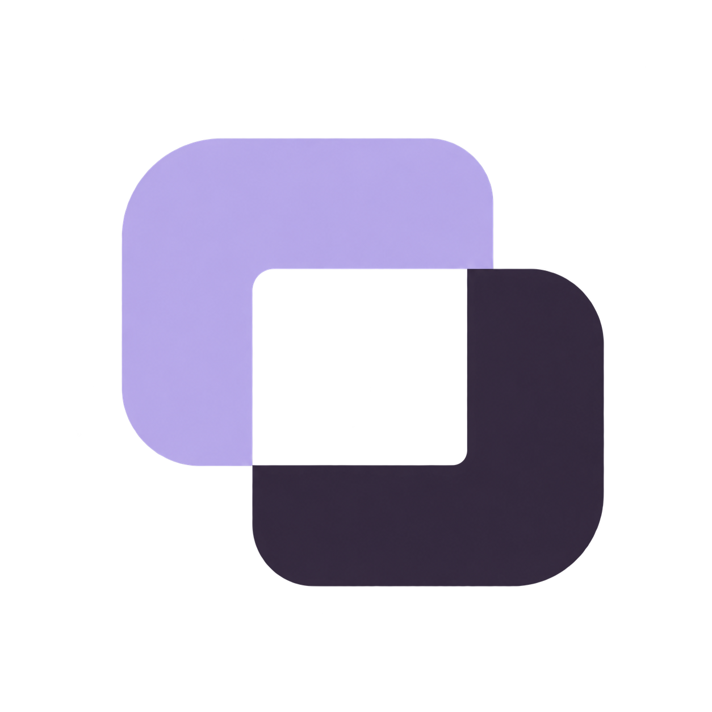
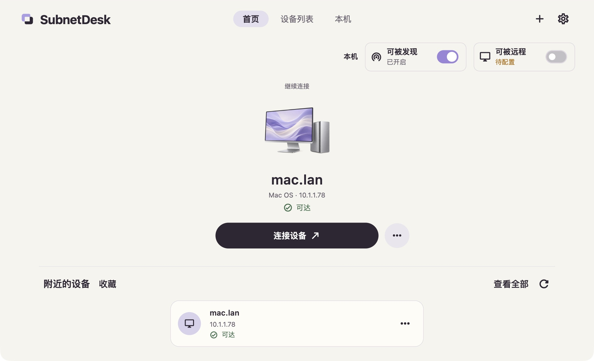
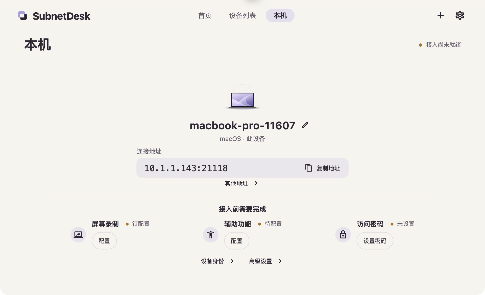
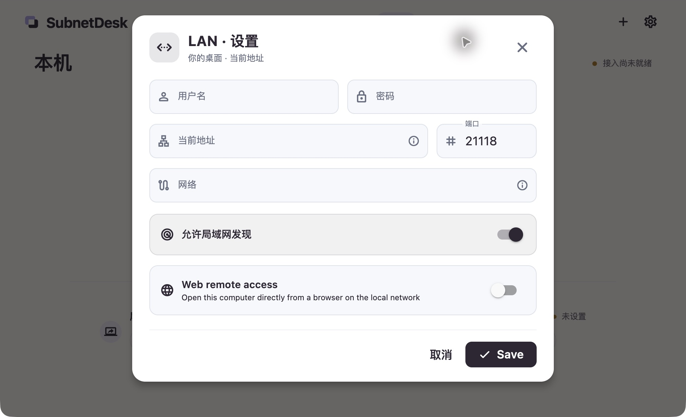

<p align="center">
  
</p>

<h1 align="center">SubnetDesk</h1>

<p align="center">
  <strong>SubnetDesk 2.0 · Remote desktop for your LAN and VPN</strong>
</p>

<p align="center">
  Discover nearby devices and connect directly by IP or hostname, without a rendezvous or relay server.<br>
  An independently maintained <a href="https://github.com/rustdesk/rustdesk">RustDesk</a> fork for Windows, macOS, Linux, and Android.
</p>

<p align="center">
  <a href="https://github.com/zibo-chen/SubnetDesk/releases"></a>
  <a href="https://github.com/zibo-chen/SubnetDesk/releases"></a>
  <a href="https://github.com/zibo-chen/SubnetDesk/stargazers"></a>
  <a href="https://github.com/zibo-chen/SubnetDesk/network/members"></a>
  <a href="https://github.com/zibo-chen/SubnetDesk/actions/workflows/subnetdesk-preflight.yml"></a>
  <a href="LICENCE"></a>
</p>

<p align="center">
  
  
  
  
</p>

<p align="center">
  English · <a href="README.zh-CN.md">简体中文</a>
</p>

<p align="center">
  <a href="#why-subnetdesk">Why SubnetDesk</a> ·
  <a href="#features">Features</a> ·
  <a href="#download">Download</a> ·
  <a href="#quick-start">Quick start</a> ·
  <a href="#build-from-source">Build</a>
</p>

<p align="center">
  
</p>
<p align="center">
  Actual 2.0 interface · New logo and unified theme · Nearby devices and quick reconnection
</p>

<a id="why-subnetdesk"></a>

## 💡 Why SubnetDesk

SubnetDesk focuses on one clear use case: remote control between devices that can already reach each other. Connect through local discovery or a manually entered address, without public device IDs, cloud accounts, or a coordination server.

That makes it a good fit for home labs, offices, classrooms, on-site support, and private networks connected by WireGuard, Tailscale, OpenVPN, or another VPN.

| | SubnetDesk | Typical RustDesk deployment |
| --- | --- | --- |
| Connection | Direct IP address or hostname | Device ID through rendezvous, with optional relay |
| Discovery | Automatic mDNS discovery on the LAN | Device ID or address book |
| Server dependency | No coordination server required | Public or self-hosted rendezvous/relay server |
| Best suited for | LANs, routed private networks, and VPNs | Internet and cross-NAT access |

> [!IMPORTANT]
> SubnetDesk does not provide Internet rendezvous or relay services. The two devices must be reachable through the same LAN, a routed private network, or a VPN.

<a id="features"></a>

## ✨ Features

| Capability | The 2.0 experience |
| --- | --- |
| New interface | A unified logo, device artwork, and light/dark themes, with dedicated Home, Devices, and This device views. |
| Discovery and direct connections | Find nearby devices over mDNS, or connect by IPv4, IPv6, or hostname. The default TCP port is `21118`. |
| Recents and favorites | Continue a connection from Home and organize favorite devices into groups. |
| Local access controls | Control discovery and incoming remote access separately; see password, system permission, and access readiness in one place. |
| Remote tools | Remote control, file transfer, terminal, clipboard, and audio, subject to platform support and host permissions. |
| Session windows | Switch between session tabs; drag, pin, or automatically hide the floating remote toolbar. |
| Access protection | Username/password authentication, device fingerprint verification, and CIDR source allowlists. The host stores its access password as an Argon2id hash. |
| Browser access | Optional HTTPS access to desktop hosts from a WebCodecs-capable browser. |
| Desktop updates | Windows/macOS support signature-verified updates when configured in the release build; manual downloads remain available. |

<a id="download"></a>

## 📦 Download

Choose a 2.0 package from **[GitHub Releases](https://github.com/zibo-chen/SubnetDesk/releases)** for your operating system and CPU. Use `x86_64` for Intel/AMD PCs, and `aarch64`/`ARM64` for Apple Silicon, Windows on ARM, or ARM Linux.

| Platform | Architectures | Packages |
| --- | --- | --- |
| Windows x64 | Intel/AMD 64-bit | Recommended: `*-x86_64-setup.exe` or `*-x86_64-portable.zip` (Win7 SP1 and later); MSI and self-extracting EXE share the same runtime |
| Windows ARM64 | Windows on ARM | `*-aarch64-portable.zip`, `.msi`, self-extracting `.exe`; not for Win7 |
| macOS | Intel, Apple Silicon | `.dmg` |
| Linux | x86_64, ARM64 | `.deb`, `.rpm`, `.AppImage`, `.flatpak`; Arch package on x86_64 |
| Android | ARM64, ARMv7, x86_64, universal | `.apk` |

> [!NOTE]
> A release marked **Pre-release** is still a release candidate. The [latest stable link](https://github.com/zibo-chen/SubnetDesk/releases/latest) may point to an earlier version. [Nightly](https://github.com/zibo-chen/SubnetDesk/releases/tag/nightly) contains development changes.

### Install and upgrade

- **Windows**: Extract the complete portable ZIP and launch the top-level `SubnetDesk.exe`; keep the directory together. Exit from the tray before upgrading, and preserve a backup of `userdata/`, which contains configuration, device identity, and logs. All x64 formats use the same hardware-enabled runtime: supported GPU codecs are detected at runtime, with software encoding as fallback. See the [Win7 package notes](docs/win7/README.md) for scope and validation limits.
- **macOS**: Open the DMG for your architecture and drag SubnetDesk into Applications. To receive remote connections, follow the screen recording and accessibility permission prompts in This device.
- **Linux**: Choose the package for your distribution. 2.0 ships regular desktop packages; the separate DRM unattended/login-screen package is on hold. See [host readiness notes](docs/linux-host-readiness.md) for Wayland and login-screen limits.
- **Android**: Install the APK; choose `universal` if unsure of your architecture. Receiving remote connections also requires the screen-sharing and input permissions requested by the app.

On Windows/macOS, check update status under **Settings → About**. If automatic updates are unavailable, upgrade from Releases manually; portable builds also use manual upgrades. See [automatic updates](docs/automatic-updates.md).

<a id="quick-start"></a>

## 🚀 Quick start

Install and open SubnetDesk on both devices. The steps below use the desktop interface: the **host** is the device you want to access; the **controller** starts the connection. Screenshots show the Chinese UI.

### 1. Prepare the host

1. Open **This device → Set password** and save an access username and password in **LAN · Settings**. The action reads **Change password** when already configured.
2. Complete the screen recording, input control, administrator access, or other prerequisites shown in This device.
3. Return to Home and enable **Remote access**. Also enable **Discoverable** if you want other LAN devices to find this host automatically.
4. Copy the connection address from This device. The default port is `21118`; LAN settings also let you change listen addresses, the port, and allowed source CIDRs.

<p align="center">
  
</p>

> **Discoverable and Remote access are separate controls.** Discovery makes the device visible; incoming connections also need a configured password, system permissions, and remote access enabled. A controller does not need to enable incoming access to connect to another device.

<details>
<summary>View LAN access settings</summary>

<p align="center">
  
</p>

</details>

### 2. Connect from the controller

1. Select a host under **Nearby devices** on Home or in **Devices**. If it is not discovered, use **＋** in the top-right corner to enter its address.
2. On the first connection, compare the displayed fingerprint with the full fingerprint under **This device → Device identity** on the host, then trust it and continue.
3. Authenticate with the host's access username and password. Manage saved connection credentials under **Settings → Security & credentials**.

Example addresses:

```text
192.168.1.20
192.168.1.20:21118
workstation.local:21118
[fd00::20]:21118
```

Across subnets or a VPN, enter the host's reachable address directly. mDNS usually does not cross routers or VPNs, so a device can be reachable without appearing in discovery.

### 3. Use remote tools

- Open a device's **⋯** menu or details to start **File transfer**, **Terminal**, or another tool allowed by the host.
- Use the floating remote toolbar for display, input, and session controls. Pin it to keep it visible, or reveal it from its edge handle after it hides.
- Add frequent devices to favorites for quick access from Home or a favorite group.

### Optional: connect from a browser

Enable **Web remote access** in the desktop host's **LAN · Settings** and configure listen addresses, allowed source networks, hosts, and a permission profile. After saving, open **Browser access** in This device to find the actual HTTPS URL. Follow the instructions to trust the host's generated local CA on the client, or use a valid certificate covering the access hostname. The browser must support WebCodecs and still authenticates with the host's access credentials. See the [Web client notes](web/README.md).

### Troubleshooting

| Symptom | Check first |
| --- | --- |
| Device not listed | Enable Discoverable on the host and allow mDNS on the network, or enter the IP/hostname directly. |
| Timeout or connection refused | Check routing, the host's Remote access toggle, and firewall access to TCP `21118` or your custom port. |
| Address reachable but access denied | Check the host's source CIDR allowlist and access username/password. A blank Network field uses built-in LAN/VPN ranges. |
| Video or input does not work | Check permissions in This device; on Linux also check Wayland, SELinux, and the login session. |
| Fingerprint changed | Independently verify the full fingerprint on the host before trusting it again. Reinstalling or clearing device identity can also change it. |

## 🔒 Security model

- Traffic stays on the network path between your devices; SubnetDesk does not require a public coordination service.
- The host's access password is persisted as an Argon2id hash rather than plaintext.
- Device fingerprints provide trust-on-first-use verification and help detect an unexpected endpoint identity change.
- CIDR allowlists let the controlled device limit which source networks may connect.

As with any remote-control software, expose the listening port only to trusted networks, use a strong unique password, and verify fingerprints through a separate trusted channel when possible.

See the [SubnetDesk Privacy Policy](PRIVACY.md) for session data, local storage, update requests, and deletion controls.

<a id="build-from-source"></a>

## 🛠️ Build from source

Clone the repository with its submodules, then run the Flutter desktop build:

```bash
git clone --recurse-submodules https://github.com/zibo-chen/SubnetDesk.git
cd SubnetDesk
./build.py --flutter --hwcodec
```

The build requires Rust, Flutter, and platform-specific native dependencies. The [native package workflow](.github/workflows/flutter-build.yml) is the source of truth for pinned tool versions, target architectures, and packaging steps.

## 🤝 Contributing

Bug reports, feature ideas, and pull requests are welcome. Before opening a change, check the existing [issues](https://github.com/zibo-chen/SubnetDesk/issues) and keep changes focused on the LAN/VPN-first product scope.

## 💬 Community

<p align="center">
  <a href="https://discord.gg/MFZG478wPQ">
    
  </a>
</p>

<p align="center">
  Join the <a href="https://discord.gg/MFZG478wPQ">SubnetDesk Discord community</a>, or scan the QR code below to add me on WeChat. Mention <strong>SubnetDesk</strong>, and I will invite you to the WeChat group.
</p>

<p align="center">
  
</p>

## 🙏 Credits and license

SubnetDesk is based on [RustDesk](https://github.com/rustdesk/rustdesk) and retains its open-source foundations. SubnetDesk is an independent project and is not an official RustDesk release.

Licensed under the [GNU Affero General Public License v3.0](LICENCE). Use remote-control software only on systems you own or are authorized to administer.
