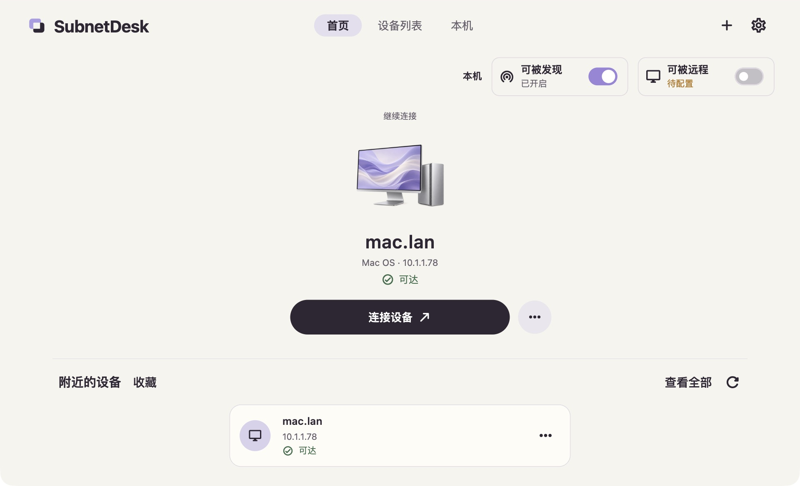
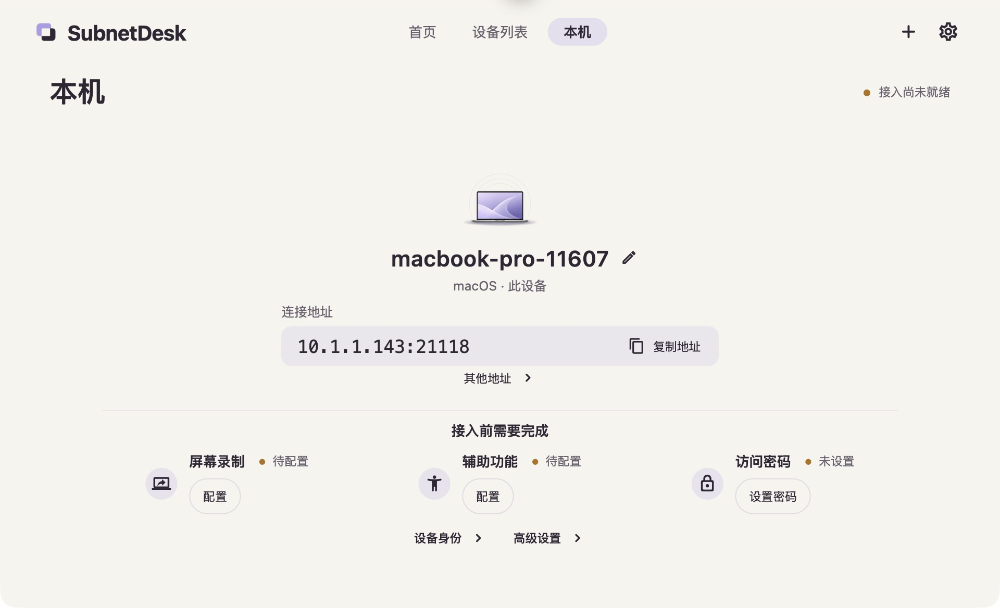
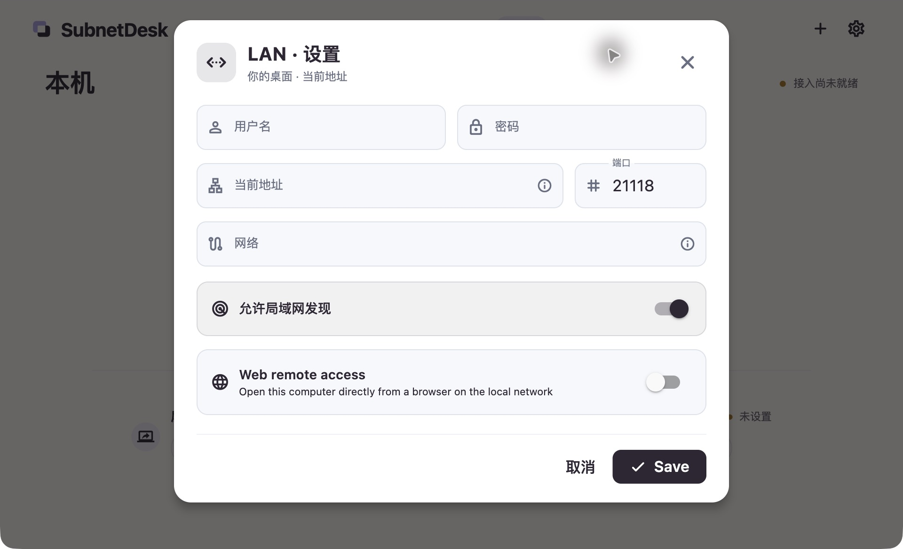

<p align="center">
  
</p>

<h1 align="center">SubnetDesk</h1>

<p align="center">
  <strong>SubnetDesk 2.0 · 局域网与 VPN 内的远程桌面</strong>
</p>

<p align="center">
  自动发现附近设备，直接连接 IP 或主机名，无需搭建信令或中继服务器。<br>
  基于 <a href="https://github.com/rustdesk/rustdesk">RustDesk</a> 独立维护，支持 Windows、macOS、Linux 和 Android。
</p>

<p align="center">
  <a href="https://github.com/zibo-chen/SubnetDesk/releases"></a>
  <a href="https://github.com/zibo-chen/SubnetDesk/releases"></a>
  <a href="https://github.com/zibo-chen/SubnetDesk/stargazers"></a>
  <a href="https://github.com/zibo-chen/SubnetDesk/network/members"></a>
  <a href="https://github.com/zibo-chen/SubnetDesk/actions/workflows/subnetdesk-preflight.yml"></a>
  <a href="LICENCE"></a>
</p>

<p align="center">
  
  
  
  
</p>

<p align="center">
  <a href="README.md">English</a> · 简体中文
</p>

<p align="center">
  <a href="#why-subnetdesk">项目定位</a> ·
  <a href="#features">主要功能</a> ·
  <a href="#download">下载安装</a> ·
  <a href="#quick-start">快速开始</a> ·
  <a href="#build-from-source">源码构建</a>
</p>

<p align="center">
  
</p>
<p align="center">
  2.0 实际界面 · 新 Logo 与统一主题 · 附近设备与快速重连
</p>

<a id="why-subnetdesk"></a>

## 💡 为什么选择 SubnetDesk

SubnetDesk 专注于一个明确场景：让本身已经网络互通的设备直接进行远程控制。通过局域网发现或手动输入地址建立连接，无需公网设备 ID、云账号或协调服务器。

它适合家庭实验室、办公室、教室、现场运维，以及通过 WireGuard、Tailscale、OpenVPN 等 VPN 互通的私有网络。

| | SubnetDesk | 典型 RustDesk 部署 |
| --- | --- | --- |
| 连接方式 | 直接连接 IP 地址或主机名 | 通过设备 ID 和信令服务连接，可使用中继 |
| 设备发现 | 局域网 mDNS 自动发现 | 设备 ID 或地址簿 |
| 服务依赖 | 无需协调服务器 | 设备 ID 连接通常需要公网或自建信令/中继服务 |
| 适用场景 | 局域网、可路由私网、VPN | 互联网和跨 NAT 访问 |

> [!IMPORTANT]
> SubnetDesk 不提供公网信令或中继服务。两台设备必须位于同一局域网、可路由的私有网络，或通过 VPN 实现网络互通。

<a id="features"></a>

## ✨ 主要功能

| 功能 | 2.0 中的使用体验 |
| --- | --- |
| 全新界面 | 统一 Logo、设备插画与浅色／深色主题，首页、设备列表、本机各有独立入口。 |
| 设备发现与直连 | mDNS 自动发现附近设备，也可通过 IPv4、IPv6 或主机名连接，默认 TCP 端口 `21118`。 |
| 最近连接与收藏 | 从首页继续连接，收藏常用设备并按分组整理。 |
| 本机接入管理 | 分别控制“可被发现”和“可被远程”，集中查看访问密码、系统权限与接入状态。 |
| 远程工具 | 远程控制、文件传输、终端、剪贴板和音频；具体能力取决于平台与被控端授权。 |
| 会话窗口 | 通过标签切换会话，远控悬浮工具栏支持拖动、固定与自动收起。 |
| 访问保护 | 用户名与密码认证、设备指纹核对、CIDR 来源网络白名单；被控端访问密码以 Argon2id 哈希保存。 |
| 浏览器接入 | 可选开启 HTTPS Web 接入，通过支持 WebCodecs 的浏览器访问桌面端设备。 |
| 桌面更新 | Windows／macOS 支持签名校验的更新流程；可用性取决于发布包配置，也可手动下载安装。 |

<a id="download"></a>

## 📦 下载安装

前往 **[GitHub Releases](https://github.com/zibo-chen/SubnetDesk/releases)** 选择 2.0 安装包，并按操作系统和 CPU 架构下载。普通 Intel／AMD 电脑选择 `x86_64`，Apple Silicon、Windows on ARM 和 ARM Linux 选择 `aarch64`／`ARM64`。

| 平台 | 架构 | 安装包 |
| --- | --- | --- |
| Windows x64 | Intel／AMD 64 位 | 推荐 `*-x86_64-setup.exe` 安装版或 `*-x86_64-portable.zip` 绿色版（面向 Win7 SP1 及以上）；另有 Win10+ 专用包 |
| Windows ARM64 | Windows on ARM | `*-aarch64-portable.zip`、`.msi`、自解压 `.exe`；不适用于 Win7 |
| macOS | Intel、Apple Silicon | `.dmg` |
| Linux | x86_64、ARM64 | `.deb`、`.rpm`、`.AppImage`、`.flatpak`；另提供 x86_64 Arch 包 |
| Android | ARM64、ARMv7、x86_64、通用包 | `.apk` |

> [!NOTE]
> 标注 **Pre-release** 的版本仍是发布候选版。[最新稳定版](https://github.com/zibo-chen/SubnetDesk/releases/latest)可能仍指向较早版本；[Nightly](https://github.com/zibo-chen/SubnetDesk/releases/tag/nightly) 用于体验开发中的改动。

### 安装与升级

- **Windows**：绿色版请完整解压后运行顶层 `SubnetDesk.exe`，不要单独移动其中的程序文件。升级前从托盘退出，保留并备份 `userdata/`，其中包含配置、设备身份与日志。Win10+ 包带 `-win10-portable.zip` 后缀，或使用 `.msi`／自解压 `.exe`。Win7 构建范围与验证边界见[兼容包说明](docs/win7/README.md)。
- **macOS**：打开对应架构的 `.dmg`，将 SubnetDesk 拖入“应用程序”。作为被控端时，按“本机”页提示授予屏幕录制和辅助功能权限。
- **Linux**：按发行版选择安装包。2.0 提供常规桌面包，独立 DRM 无人值守／登录界面包暂缓发布；Wayland 与登录界面限制见[主机环境说明](docs/linux-host-readiness.md)。
- **Android**：安装 `.apk`，不确定架构时选择 `universal` 通用包。作为被控端时，还需按应用提示授予屏幕共享和输入控制权限。

Windows／macOS 可在 **设置 → 关于** 查看更新状态。若提示自动更新不可用，使用发布页手动升级；绿色版也使用手动升级。详见[更新机制说明](docs/automatic-updates.md)。

<a id="quick-start"></a>

## 🚀 快速开始

先在双方设备上安装并打开 SubnetDesk。以下以桌面端为例：**被控端**是要被访问的设备，**控制端**是发起连接的设备。

### 1. 配置被控端

1. 打开 **本机 → 设置密码**，在 **LAN · 设置** 中填写接入用户名和密码并保存。已有密码时入口显示为“修改密码”。
2. 按“本机”页提示完成屏幕录制、输入控制或管理员权限等准备，直至相关项目就绪。
3. 返回首页，开启 **可被远程**。需要在局域网内自动展示本机时，再开启 **可被发现**。
4. 在“本机”页复制连接地址。默认端口为 `21118`；监听地址、端口与允许接入的 CIDR 网段可在 LAN 设置中调整。

<p align="center">
  
</p>

> **可被发现 ≠ 可被远程。** 开启发现只允许其他设备找到本机；接收远程连接还需要访问密码、系统权限和远程开关就绪。只用来控制其他设备时，无需为本机开启远程接入。

<details>
<summary>查看 LAN 访问设置界面</summary>

<p align="center">
  
</p>

</details>

### 2. 从控制端连接

1. 在首页“附近的设备”或“设备列表”中找到目标并连接；未发现目标时，点击右上角 **＋** 手动输入地址。
2. 首次连接时，将显示的设备指纹与被控端 **本机 → 设备身份** 中的完整指纹核对，确认后信任并继续。
3. 输入被控端设置的用户名与密码完成认证。保存的连接凭据可在 **设置 → 安全与凭据** 中管理。

支持的地址示例：

```text
192.168.1.20
192.168.1.20:21118
workstation.local:21118
[fd00::20]:21118
```

跨网段或通过 VPN 连接时，直接输入目标的可达地址；mDNS 通常不会穿过路由器或 VPN，未自动发现并不代表无法连接。

### 3. 使用远程工具

- 在设备的 **⋯** 菜单或详情页中选择 **文件传输**、**终端** 等工具，按被控端允许的能力建立会话。
- 远控窗口中的悬浮工具栏可调整显示、输入与会话选项；需要常驻时固定，收起后从边缘把手唤出。
- 常用设备可加入收藏，之后从首页或收藏分组快速连接。

### 可选：从浏览器访问

在被控桌面端的 **LAN · 设置** 中开启 **Web remote access**，配置监听地址、允许的来源网络、主机名及权限档位。保存后，从“本机”页的 **浏览器接入** 查看实际 HTTPS 地址，并在客户端按说明信任本机生成的 CA，或使用覆盖访问主机名的有效证书。浏览器需支持 WebCodecs，连接时仍使用被控端的接入凭据。详见 [Web 客户端说明](web/README.md)。

### 连接问题排查

| 现象 | 优先检查 |
| --- | --- |
| 找不到设备 | 被控端“可被发现”是否开启、网络是否允许 mDNS；也可直接输入 IP／主机名。 |
| 连接超时或被拒绝 | 双方路由是否可达、被控端“可被远程”是否开启、防火墙是否放行 TCP `21118` 或自定义端口。 |
| 地址可达但不能接入 | 被控端的 CIDR 白名单是否包含控制端来源地址，访问用户名与密码是否正确。网络字段留空使用内置 LAN／VPN 默认范围。 |
| 能连接但画面或输入异常 | 被控端“本机”页的权限是否就绪；Linux 另需检查 Wayland、SELinux 与登录会话状态。 |
| 设备指纹发生变化 | 先在被控端独立核对完整指纹，再决定是否重新信任；重装或清除设备身份也可能导致变化。 |

## 🔒 安全模型

- 数据沿设备之间的可达网络路径传输，不依赖公网协调服务。
- 被控端的访问密码使用 Argon2id 哈希保存，不以明文持久化。
- 设备指纹采用首次使用信任机制，可帮助识别目标设备身份的异常变化。
- CIDR 白名单可限制被控端接受连接的来源网络。

与其他远程控制软件一样，请只向可信网络开放监听端口，使用高强度且不重复的密码，并尽可能通过另一条可信渠道核对设备指纹。

会话数据、本地存储、更新请求和删除方式，请参阅 [SubnetDesk 隐私政策（英文）](PRIVACY.md)。

<a id="build-from-source"></a>

## 🛠️ 从源码构建

拉取仓库及其子模块，然后执行 Flutter 桌面端构建：

```bash
git clone --recurse-submodules https://github.com/zibo-chen/SubnetDesk.git
cd SubnetDesk
./build.py --flutter --hwcodec
```

构建需要 Rust、Flutter 和对应平台的原生依赖。固定工具版本、目标架构和完整打包步骤以[原生安装包工作流](.github/workflows/flutter-build.yml)为准。

## 🤝 参与贡献

欢迎提交缺陷报告、功能建议和 Pull Request。开始修改前建议先查看现有 [Issues](https://github.com/zibo-chen/SubnetDesk/issues)，并尽量让改动保持聚焦，符合项目面向局域网与 VPN 的产品定位。

## 💬 交流社区

<p align="center">
  <a href="https://discord.gg/MFZG478wPQ">
    
  </a>
</p>

<p align="center">
  欢迎加入 <a href="https://discord.gg/MFZG478wPQ">SubnetDesk Discord 交流社区</a>。也可以扫描下方二维码添加我的微信，备注 <strong>SubnetDesk</strong>，我会拉你进入微信交流群。
</p>

<p align="center">
  
</p>

## 🙏 致谢与许可

SubnetDesk 基于 [RustDesk](https://github.com/rustdesk/rustdesk) 开发并保留其开源基础。本项目独立维护，并非 RustDesk 官方发行版。

项目采用 [GNU Affero General Public License v3.0](LICENCE) 许可。请仅在自己拥有或已获授权的设备上使用远程控制功能。
